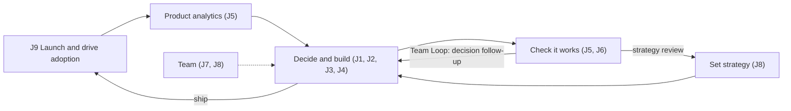

# Data Product Operator

**Decisions, not dashboards.** Skills, loops and a team workspace for data leaders, data product operators, and their teams.

Decide what is worth building. Help a team deliver it. Check whether it changed the outcome it was built for. Every skill is a Markdown file you can read, run in Claude Code, or hand to another assistant.

Built by [Kevin Holland](https://kevintholland.com). Terms follow the [glossary](GLOSSARY.md). The reasons follow the [first principles](docs/first-principles.md).

## The cycle

The jobs form a cycle, not a line. A launch feeds product analytics. Analytics feeds the next decision. The check that the product works loops back twice: to decisions through the Team Loop, and to strategy through the strategy review.



## Quick start (60 seconds)

In Claude Code, add the marketplace and install the plugin:

```text
/plugin marketplace add hollandkevint/data-product-operator
/plugin install data-product-operator@data-product-operator
```

Open a new session in an empty folder for one data product, then set up a Team Loop workspace:

```text
/data-product-operator:team-loop
```

It asks about your product, copies the workspace without overwriting anything, runs the validator and gives you three first actions. Your first weekly packet goes in `packets/`.

No Claude Code? The workspace is plain Markdown. Copy it and run the validator by hand:

```bash
git clone https://github.com/hollandkevint/data-product-operator.git
mkdir my-product
cp -Rn data-product-operator/skills/team-loop/scaffold/. my-product/
python3 my-product/scripts/validate.py my-product
```

The validator prints nothing and exits 0 when the workspace is sound. It needs only `python3`. For local plugin work, run `claude --plugin-dir /path/to/data-product-operator`.

## Example: one weekly packet

The weekly packet is the Team Loop's main artifact. Decisions come first. This one is filled with made-up data for a fictional retailer. It follows `skills/team-loop/scaffold/packets/_TEMPLATE.md`, and a repo test drops it into a fresh workspace and runs the validator on it.

```markdown
---
title: Weekly decision packet
owner: Priya Patel
week: 2026-11-16
status: ready
---

# Weekly decision packet

## Decisions requested

| Decision | Decider | Recommendation | Evidence gap | Consequence of delay |
| --- | --- | --- | --- | --- |
| Ship the returns-rate table to the merchandising team | Marcus Chen | Ship to two buyers first, behind the launch gate | Refund timing for marketplace orders is not yet in the source | Buyers keep pulling returns by hand for the December reset |

## Changed evidence

- The returns rate now joins on order line, not order. Multi-item orders no longer count as one return.  `(hub, returns-rate review, 2026-11-13)`
- Two of three buyers say they would drop their own spreadsheet if the table refreshes daily.  `(stakeholder-verbal, Dana Ortiz, 2026-11-12)`
- Marketplace refunds land up to 9 days late. The rate looks low for the last week of each month.  `(hub, refund lag check, 2026-11-14)`

## Recommendation and dissent

Ship to two buyers next week with a banner on the last 9 days. Sam Okafor dissents: he wants marketplace orders left out until refund timing is fixed.

## Blockers and asks by owner

- **Sam Okafor:** confirm the refund event is in the nightly load by Wednesday.
- **Dana Ortiz:** name the two buyers for the first release.

## Risks and unknowns

| Risk or unknown | Owner | Next check | Trigger |
| --- | --- | --- | --- |
| Late refunds make the rate look low | Sam Okafor | Compare month-end rate to the 9-day-later rate | Gap above 0.5 points |
| Buyers keep their spreadsheets | Dana Ortiz | Ask both buyers after week two | Either buyer still exports by hand |

## Next actions

| Action | Owner | Due or trigger | Done means |
| --- | --- | --- | --- |
| Add the late-refund banner | Priya Patel | 2026-11-19 | Banner shows on the last 9 days |
| Run the launch gate | Marcus Chen | 2026-11-20 | Gate checklist signed or sent back |

## Reviewer note

Marcus reviews the launch gate on Friday 2026-11-20 and records the call in the decision log.
```

## Match grid

The [match grid](docs/match-grid.md) puts nine jobs against nine source packs: this repo, Team Loop, kh-os, Pawel Huryn's two packs, 90n, Aakash Gupta's two packs, and Matt Pocock. Each cell names the skill that does the job, or says `gap`.

What this repo adds that the outside packs lack: the owner, consumer and contract for a data product (J3.2), data quality and retirement (J4.2, J4.6), unexplained metric moves (J6.1), analytics-agent evals (J4.3, J6.2), one metric glossary (J3.1, J7.2), and the follow-up that closes the cycle (J5.1, J8.2, J9). Open gaps, such as a prototype skill (J4.4) and an experiment skill (J5.2), are listed in its gap notes.

## Person, team, company

The system grows in three layers. Use the one your problem needs.

| Layer | Who | What is here |
| --- | --- | --- |
| Person | The data product operator | Skills for the nine jobs, a [glossary](GLOSSARY.md) and [first principles](docs/first-principles.md) |
| Team | The data product team | [Team Loop](team-loop/README.md) for the daily and weekly cycle, and five loops, including the quarterly [strategy review](skills/strategy-review/SKILL.md) |
| Company | Data leaders across many products | On the roadmap only. Nothing here is built for it yet. |

## Jobs and skills

A skill is a Markdown file of instructions. Links open it directly. The jobs are the rows of the [match grid](docs/match-grid.md).

### Decide

| Job | Skills |
| --- | --- |
| J1 Frame the decision and learn the need | [Data Product Operator](skills/data-product-operator/SKILL.md) (start here), [dashboards to decisions](skills/dashboards-to-decisions/SKILL.md), [data product thinking](skills/data-product-thinking/SKILL.md), [consumer discovery](skills/data-consumer-discovery/SKILL.md), [research synthesis](skills/research-synthesis-data/SKILL.md), [product validation](skills/data-product-validation/SKILL.md), [market advantage review](skills/arbitrage-audit-data/SKILL.md) |
| J2 Prioritize, decide and record it | [Team positioning](skills/data-team-positioning/SKILL.md), [Team Loop](skills/team-loop/SKILL.md) decision log |

### Deliver

| Job | Skills |
| --- | --- |
| J3 Define the metric, owner and contract | [Metric definitions](skills/metrics-definition/SKILL.md), [metric glossary](skills/metric-glossary/SKILL.md), [data dictionary grill](skills/data-dictionary-grill/SKILL.md), [pipeline quality](skills/data-pipeline-quality/SKILL.md), [Team Loop](skills/team-loop/SKILL.md) data contract |
| J4 Build, check, ship and retire | [Model design](skills/data-model-design/SKILL.md), [quality assessment](skills/data-quality-assessment/SKILL.md), [data quality watch](skills/data-quality-watch/SKILL.md) (loop), [analytics agent](skills/analytics-agent/SKILL.md), [agent eval regression](skills/agent-eval-regression/SKILL.md) (loop), [shipping bridge](skills/shipping-bridge/SKILL.md), [launch and adoption](skills/launch-and-adoption/SKILL.md) |

### Check outcome

| Job | Skills |
| --- | --- |
| J5 Show a decision changed | [Analyst](skills/analyst/SKILL.md) evidence graph, [data product retro](skills/data-product-retro/SKILL.md), [decision follow-up](skills/decision-follow-up/SKILL.md) (loop) |
| J6 Govern use and evaluate outputs | [Ethical risk assessment](skills/ethical-risk-assessment/SKILL.md), [weekly metric review](skills/weekly-metric-review/SKILL.md) (loop), [analytics agent](skills/analytics-agent/SKILL.md) |

### Team

| Job | Skills |
| --- | --- |
| J7 Align people and pressure-test plans | [Stakeholder alignment](skills/stakeholder-alignment/SKILL.md), [storytelling](skills/data-storytelling/SKILL.md), [question a data-product plan](skills/grill-me-data/SKILL.md), [data dictionary grill](skills/data-dictionary-grill/SKILL.md) |
| J8 Fit the operating model and set strategy | [Team operating model](skills/data-team-operating-model/SKILL.md), [strategy review](skills/strategy-review/SKILL.md) (loop), [Team Loop](skills/team-loop/SKILL.md) |

### Launch

| Job | Skills |
| --- | --- |
| J9 Launch and drive adoption | [Launch and adoption](skills/launch-and-adoption/SKILL.md), [shipping bridge](skills/shipping-bridge/SKILL.md) |

The five loops share one shape: a maker, a checker script, a state file and demo data. See the [loop pattern](docs/loop-pattern.md).

### Analytics agents

An analytics agent is a delivery surface that answers questions over your data products. Start with the [reference architecture](docs/analytics-agents/reference-architecture.md), then pick a route: [warehouse-native](docs/analytics-agents/warehouse-native.md), [open source and BI-native](docs/analytics-agents/open-source-and-bi-native.md), or [build your own](docs/analytics-agents/build-your-own.md). Team Loop includes a [sample grader](team-loop/README.md#sample-grader) on synthetic OMOP data that shows how to test a change to an agent's harness.

### Domain packs

The method stays the same. Domain packs add the definitions and edge cases that change a decision.

| Domain | What is there |
| --- | --- |
| [Healthcare](docs/healthcare-applications.md) | Dedicated skills: [readiness debrief](skills/healthcare-data-readiness-debrief/SKILL.md), [cohort design](skills/healthcare-cohort-design/SKILL.md), [reconciliation](skills/healthcare-data-reconciliation/SKILL.md), [healthcare data domain](skills/healthcare-data-domain/SKILL.md) |
| [Marketing](docs/domain-applications.md#marketing-data) | Application guide using core skills |
| [Logistics and operations](docs/domain-applications.md#logistics-and-operations) | Application guide using core skills |
| [Ecommerce](docs/domain-applications.md#ecommerce) | Application guide using core skills |

The marketing, logistics and ecommerce guides are proposed workflows, not claims of domain validation. The healthcare pack does not supply licensed measure logic or certify clinical validity. Use synthetic examples.

### Platforms, commands and connectors

- Platform skills: [Databricks data-product review](skills/databricks-data-product-review/SKILL.md) and [DuckDB data profiling](skills/duckdb-data-profiling/SKILL.md). Neither connects to a system.
- Commands for longer workflows: [run discovery](commands/run-discovery.md), [write a problem brief](commands/write-problem-brief.md), [write a data PRD](commands/write-data-prd.md), [review data quality](commands/review-data-quality.md), [review a data model](commands/review-data-model.md), [write a stakeholder brief](commands/write-stakeholder-brief.md), [reshape a sprint](commands/reshape-sprint.md).
- [Connectors](CONNECTORS.md) are optional. The skills work without them. Each one needs its own setup and access.

## Credits

- Matt Pocock, [mattpocock/skills](https://github.com/mattpocock/skills), MIT license. Adapted into grill-me-data, data-dictionary-grill, metric-glossary, data-product-retro and the healthcare readiness debrief.
- Pawel Huryn, [pm-skills](https://github.com/phuryn/pm-skills) and [product-engineering](https://github.com/phuryn/product-engineering), MIT license. Ideas adapted into shipping-bridge. Both packs are columns in the match grid.
- Aakash Gupta, [Product Growth](https://news.aakashg.com). Named and linked in the match grid and the loop pattern. None of his text is copied.
- 90n, [The Complete Claude Guide for Product Managers](https://github.com/polar-bear-org/claude-skills/tree/main/packs/complete-claude-guide-for-product-managers-pack). Named and linked in the match grid. None of its text is copied.
- The authors behind the nine principles are credited by name, with links, on the [first principles](docs/first-principles.md#credits) page.

Each adapted skill ends with a `Source:` line. The rules are in [adapted skills](docs/adapted-skills.md).

## Formerly dpm_os

Team Loop was a separate repo, dpm_os. It now lives here, with its history. The workspace and initializer are in [skills/team-loop](skills/team-loop/SKILL.md), and the command `/dpm-os` is now `/team-loop`. The docs and the sample grader are in [team-loop/](team-loop/README.md). The [v2.0.0 release notes](docs/releases/v2.0.0.md) list every moved path and the steps to upgrade a fork.

## Limits

The repo checks run in CI with `python -m unittest discover -s tests`. They check structure: links, manifests, the glossary, the grid, loop checkers, the grader and the Team Loop validator. They do not check whether the advice is right for your team. Databricks has not been tested against a live workspace. No test here shows production readiness, regulatory acceptance or measured team performance.

## Contributing and license

Open an issue with the task, what you expected and what you saw. Use synthetic examples. Follow [CLAUDE.md](CLAUDE.md), keep guidance beside its skill, and say what you tested.

[MIT license](LICENSE).
