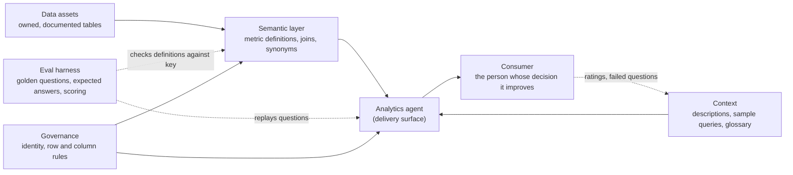

# Analytics agent: reference architecture

This page names the parts every analytics agent needs, whatever route you pick. It uses the repo's [glossary](../../GLOSSARY.md) terms and names no vendor. The route pages map products onto it.

An analytics agent is a delivery surface. It answers questions in natural language over one or more data products. It is never the data product itself.

## The parts

| Part | Job | Owner question |
| --- | --- | --- |
| Data assets | The tables the answers come from. Each has a named owner and documentation. | Who fixes a bad column? |
| Semantic layer | One definition per metric, with grain and time window. The agent asks for "active patients" by name instead of writing its own join. Curated views do the same job at small scale. | Who approves a definition change? |
| Context | Descriptions, synonyms, sample queries and a glossary the agent reads. It decays as schemas change. | Who reads the failures each week? |
| Analytics agent | Turns a question into a query or a metric request, runs it, and shows the answer with its SQL and sources. | Who decides which questions it may refuse? |
| Governance | Identity passthrough, row-level rules and column masking, applied to the agent's queries. | Who can see what, and is it enforced at the data layer? |
| Consumer | The named person whose decision the answer feeds. | What decision changed? |
| Eval harness | A fixed set of golden questions with trusted answers. It replays them against the agent and scores them. | Who owns the question set? |

## How the pieces connect

- The agent reads definitions from the semantic layer. When a definition is missing, the agent should ask or refuse, not guess.
- The eval harness sits beside the agent, not inside it. It asks the same questions a consumer would and compares the answer with a key computed from the governed data.
- The harness also catches definition drift. If a metric changes and the key does not, scores drop and you see it.
- Failed questions and downvotes flow back into context. Wrong answers that reach a consumer become new golden questions.
- Governance applies to the agent and to the harness. Test with the same identity a consumer has.

## What to build first

1. Definitions for the five to ten metrics the consumer asks about most.
2. A golden set of 30 questions over those metrics. See the [analytics-agent skill](../../skills/analytics-agent/SKILL.md).
3. The narrowest agent that can answer them, with human review of every answer.
4. Widen the scope only when the golden set holds.

A worked golden-question set, with a scorer, is in [`team-loop/grader/`](../../team-loop/grader/).

## Routes

- [Warehouse-native](warehouse-native.md): the platform holding your data supplies the semantic layer, the agent and some eval tools.
- [Build your own](build-your-own.md): you assemble an agent from a framework, data access tools and your own eval suite.
- [Open source and BI-native](open-source-and-bi-native.md): an open-source agent, or the AI built into your BI tool.
