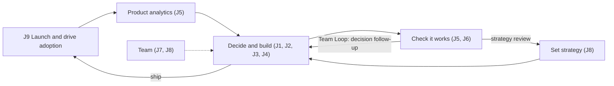

# Match grid

The match grid shows nine jobs a data product team has to do, against nine source packs. Each cell names the skill that does the job, or says `gap`. Use it to see what to install, and what this repo still has to build.

The jobs come from [first principles](first-principles.md). J1 to J8 are the eight jobs on that page. J9, launch and drive adoption, sits outside the four groups of that page and closes the cycle. Terms follow the [glossary](../GLOSSARY.md).

## The cycle

The jobs are a cycle, not a line. A launch feeds product analytics. Analytics feeds the next decision. The check that the product works then loops back twice: to decisions through the Team Loop, and to strategy through the strategy review.

## How to read the grid

- Rows are jobs, grouped Decide, Deliver, Check outcome, Team and Launch. A job with more than one topic has sub-rows, such as J4.1 to J4.6.
- Columns are source packs, in a fixed order. Data Product Operator and Team Loop are this repo. The other seven are outside packs.
- A cell holds one of three things. A link to a skill in this repo. The name of an outside skill with a link to its pack. The word `gap`.
- kh-os is Kevin Holland's own skill repo. It is private, so its cells give skill names without links.
- Aakash Gupta's packs are paid. Those cells link to his public page and carry skill names only. 90n cells link to the public pack folder. No text is copied from either.
- The grid shows today's skills only. New skills will fill gaps as they ship, and the grid is refreshed then.
- Tests in `tests/checks_grid.py` guard the grid: all nine columns in order, all nine jobs present, no empty cell, no link to a missing skill, names and links only in outside cells.

## The grid

### Decide (J1 and J2)

| Job | Data Product Operator | Team Loop | kh-os | Pawel pm-skills | Pawel product-engineering | 90n PM guide | Aakash PM-OS | Aakash loops and graphs | Matt Pocock |
|---|---|---|---|---|---|---|---|---|---|
| J1.1 Frame the decision | [dashboards-to-decisions](../skills/dashboards-to-decisions/SKILL.md) [data-product-thinking](../skills/data-product-thinking/SKILL.md) | [team-loop](../skills/team-loop/SKILL.md) | `problem-framing` `decision-brief` | gap | gap | [pmg-map-jobs-to-be-done](https://github.com/polar-bear-org/claude-skills/tree/main/packs/complete-claude-guide-for-product-managers-pack) | gap | gap | [grilling](https://github.com/mattpocock/skills) |
| J1.2 Learn what consumers need | [data-consumer-discovery](../skills/data-consumer-discovery/SKILL.md) [research-synthesis-data](../skills/research-synthesis-data/SKILL.md) | gap | `assumption-mapper` `asb-interview-questions` | [pm-product-discovery:interview-script](https://github.com/phuryn/pm-skills) [pm-product-discovery:summarize-interview](https://github.com/phuryn/pm-skills) | gap | [pmg-prepare-interview-guide](https://github.com/polar-bear-org/claude-skills/tree/main/packs/complete-claude-guide-for-product-managers-pack) [pmg-synthesise-interviews](https://github.com/polar-bear-org/claude-skills/tree/main/packs/complete-claude-guide-for-product-managers-pack) | [interview-guide](https://news.aakashg.com) [user-research-synthesis](https://news.aakashg.com) | [user-research-synthesis](https://news.aakashg.com) [feedback-digest](https://news.aakashg.com) | gap |
| J1.3 Check the idea is worth building | [data-product-validation](../skills/data-product-validation/SKILL.md) [arbitrage-audit-data](../skills/arbitrage-audit-data/SKILL.md) | gap | `kill-go` `b2b-idea-vetting` | [pm-product-discovery:identify-assumptions-new](https://github.com/phuryn/pm-skills) | gap | [pmg-run-pre-mortem](https://github.com/polar-bear-org/claude-skills/tree/main/packs/complete-claude-guide-for-product-managers-pack) | gap | [prd-red-team](https://news.aakashg.com) | gap |
| J2.1 Prioritize and say no | [data-team-positioning](../skills/data-team-positioning/SKILL.md) | gap | `pull-framework` | [pm-execution:prioritization-frameworks](https://github.com/phuryn/pm-skills) [pm-product-discovery:prioritize-features](https://github.com/phuryn/pm-skills) | gap | [pmg-score-with-rice](https://github.com/polar-bear-org/claude-skills/tree/main/packs/complete-claude-guide-for-product-managers-pack) [pmg-cost-the-delay](https://github.com/polar-bear-org/claude-skills/tree/main/packs/complete-claude-guide-for-product-managers-pack) [pmg-triage-feature-requests](https://github.com/polar-bear-org/claude-skills/tree/main/packs/complete-claude-guide-for-product-managers-pack) | [prioritize](https://news.aakashg.com) | [ranking-ideas](https://news.aakashg.com) [roadmap-prioritization](https://news.aakashg.com) | [triage](https://github.com/mattpocock/skills) |
| J2.2 Decide and record it | gap | [team-loop](../skills/team-loop/SKILL.md) | `decision-brief` | gap | gap | [pmg-keep-decision-log](https://github.com/polar-bear-org/claude-skills/tree/main/packs/complete-claude-guide-for-product-managers-pack) [pmg-set-up-daci-decision](https://github.com/polar-bear-org/claude-skills/tree/main/packs/complete-claude-guide-for-product-managers-pack) | [decision-doc](https://news.aakashg.com) | [decision-doc](https://news.aakashg.com) | gap |

### Deliver (J3 and J4)

| Job | Data Product Operator | Team Loop | kh-os | Pawel pm-skills | Pawel product-engineering | 90n PM guide | Aakash PM-OS | Aakash loops and graphs | Matt Pocock |
|---|---|---|---|---|---|---|---|---|---|
| J3.1 Define the metric | [metrics-definition](../skills/metrics-definition/SKILL.md) | gap | `metrics-definition` | [pm-product-discovery:metrics-dashboard](https://github.com/phuryn/pm-skills) | gap | [pmg-pick-north-star-metric](https://github.com/polar-bear-org/claude-skills/tree/main/packs/complete-claude-guide-for-product-managers-pack) [pmg-set-success-metrics](https://github.com/polar-bear-org/claude-skills/tree/main/packs/complete-claude-guide-for-product-managers-pack) | [define-north-star](https://news.aakashg.com) [metrics-framework](https://news.aakashg.com) | [metric-definitions](https://news.aakashg.com) | [domain-modeling](https://github.com/mattpocock/skills) |
| J3.2 Name the owner, consumer and contract | [data-pipeline-quality](../skills/data-pipeline-quality/SKILL.md) | [team-loop](../skills/team-loop/SKILL.md) | gap | gap | gap | gap | gap | gap | gap |
| J4.1 Build pipelines and models | [data-model-design](../skills/data-model-design/SKILL.md) [data-pipeline-quality](../skills/data-pipeline-quality/SKILL.md) [duckdb-data-profiling](../skills/duckdb-data-profiling/SKILL.md) [healthcare-data-domain](../skills/healthcare-data-domain/SKILL.md) [healthcare-cohort-design](../skills/healthcare-cohort-design/SKILL.md) | gap | `data-model-design` `data-pipeline-quality` | gap | gap | gap | gap | gap | [tdd](https://github.com/mattpocock/skills) |
| J4.2 Keep the data correct | [data-quality-assessment](../skills/data-quality-assessment/SKILL.md) [healthcare-data-reconciliation](../skills/healthcare-data-reconciliation/SKILL.md) | gap | `data-quality-assessment` | gap | gap | gap | gap | gap | [diagnosing-bugs](https://github.com/mattpocock/skills) |
| J4.3 Build and test analytics agents | gap | gap | `pm-brain` `eval-suite` | gap | gap | [pmg-spec-the-ai-feature](https://github.com/polar-bear-org/claude-skills/tree/main/packs/complete-claude-guide-for-product-managers-pack) | gap | [eval-suite](https://news.aakashg.com) [ai-quality-watchdog](https://news.aakashg.com) | gap |
| J4.4 Prototype | gap | gap | gap | gap | gap | [pmg-write-prototype-brief](https://github.com/polar-bear-org/claude-skills/tree/main/packs/complete-claude-guide-for-product-managers-pack) | [prototype](https://news.aakashg.com) [generate-ai-prototype](https://news.aakashg.com) | gap | [prototype](https://github.com/mattpocock/skills) |
| J4.5 Ship it | [databricks-data-product-review](../skills/databricks-data-product-review/SKILL.md) | gap | `codex-build` `codex-review` | gap | [ai-shipping:ship-check](https://github.com/phuryn/product-engineering) [ai-shipping:release-gate](https://github.com/phuryn/product-engineering) [ai-shipping:code-review](https://github.com/phuryn/product-engineering) | gap | gap | gap | [code-review](https://github.com/mattpocock/skills) [pr](https://github.com/mattpocock/skills) [codebase-design](https://github.com/mattpocock/skills) |
| J4.6 Retire it when done | gap | gap | gap | gap | gap | gap | gap | [deprecation-plan](https://news.aakashg.com) | gap |

### Check outcome (J5 and J6)

| Job | Data Product Operator | Team Loop | kh-os | Pawel pm-skills | Pawel product-engineering | 90n PM guide | Aakash PM-OS | Aakash loops and graphs | Matt Pocock |
|---|---|---|---|---|---|---|---|---|---|
| J5.1 Show a decision changed | [analyst](../skills/analyst/SKILL.md) | [decision-follow-up](../skills/decision-follow-up/SKILL.md) | `loop-product-analytics` `dashboards-to-decisions` | gap | gap | [pmg-run-post-launch-review](https://github.com/polar-bear-org/claude-skills/tree/main/packs/complete-claude-guide-for-product-managers-pack) | [feature-results](https://news.aakashg.com) [retention-analysis](https://news.aakashg.com) | [experiment-readout](https://news.aakashg.com) [retention-analysis](https://news.aakashg.com) [metric-investigation](https://news.aakashg.com) | gap |
| J5.2 Run experiments | gap | gap | gap | [pm-product-discovery:brainstorm-experiments-existing](https://github.com/phuryn/pm-skills) | gap | [pmg-design-the-experiment](https://github.com/polar-bear-org/claude-skills/tree/main/packs/complete-claude-guide-for-product-managers-pack) | [experiment-metrics](https://news.aakashg.com) [experiment-decision](https://news.aakashg.com) | [ab-test-design](https://news.aakashg.com) | gap |
| J6.1 Govern use and reconcile numbers | [ethical-risk-assessment](../skills/ethical-risk-assessment/SKILL.md) [healthcare-data-reconciliation](../skills/healthcare-data-reconciliation/SKILL.md) | gap | `ethical-risk-assessment` | gap | gap | gap | gap | [metric-investigation](https://news.aakashg.com) | gap |
| J6.2 Evaluate outputs after launch | gap | gap | `eval-suite` `human-review` | [pm-execution:test-scenarios](https://github.com/phuryn/pm-skills) | [ai-shipping:independent-review](https://github.com/phuryn/product-engineering) | gap | gap | [eval-suite](https://news.aakashg.com) [ai-quality-watchdog](https://news.aakashg.com) | gap |

### Team (J7 and J8)

| Job | Data Product Operator | Team Loop | kh-os | Pawel pm-skills | Pawel product-engineering | 90n PM guide | Aakash PM-OS | Aakash loops and graphs | Matt Pocock |
|---|---|---|---|---|---|---|---|---|---|
| J7.1 Align stakeholders | [stakeholder-alignment](../skills/stakeholder-alignment/SKILL.md) [data-storytelling](../skills/data-storytelling/SKILL.md) | gap | `stakeholder-alignment` `daily-recap` | [pm-execution:stakeholder-map](https://github.com/phuryn/pm-skills) [pm-execution:summarize-meeting](https://github.com/phuryn/pm-skills) | [work-humanizer](https://github.com/phuryn/product-engineering) | [pmg-write-weekly-update](https://github.com/polar-bear-org/claude-skills/tree/main/packs/complete-claude-guide-for-product-managers-pack) | [status-update](https://news.aakashg.com) [meeting-notes](https://news.aakashg.com) | [board-deck](https://news.aakashg.com) [standup](https://news.aakashg.com) | [grill-with-docs](https://github.com/mattpocock/skills) |
| J7.2 Pressure-test a plan | [grill-me-data](../skills/grill-me-data/SKILL.md) [healthcare-data-readiness-debrief](../skills/healthcare-data-readiness-debrief/SKILL.md) | gap | `board-of-advisors-review` `grill-me-data` | [pm-execution:strategy-red-team](https://github.com/phuryn/pm-skills) [pm-execution:pre-mortem](https://github.com/phuryn/pm-skills) | gap | [pmg-run-pre-mortem](https://github.com/polar-bear-org/claude-skills/tree/main/packs/complete-claude-guide-for-product-managers-pack) | [prd-review-panel](https://news.aakashg.com) [ralph-wiggum](https://news.aakashg.com) | [prd-red-team](https://news.aakashg.com) | [grilling](https://github.com/mattpocock/skills) |
| J8.1 Fit the operating model to the stage | [data-team-operating-model](../skills/data-team-operating-model/SKILL.md) [data-product-operator](../skills/data-product-operator/SKILL.md) | [team-loop](../skills/team-loop/SKILL.md) | `data-team-operating-model` | gap | gap | [pmg-plan-the-quarter](https://github.com/polar-bear-org/claude-skills/tree/main/packs/complete-claude-guide-for-product-managers-pack) [pmg-run-the-retro](https://github.com/polar-bear-org/claude-skills/tree/main/packs/complete-claude-guide-for-product-managers-pack) | [weekly-plan](https://news.aakashg.com) [weekly-review](https://news.aakashg.com) | [quarterly-planning](https://news.aakashg.com) | gap |
| J8.2 Set strategy | [data-product-thinking](../skills/data-product-thinking/SKILL.md) [arbitrage-audit-data](../skills/arbitrage-audit-data/SKILL.md) | gap | `good-strategy-bad-strategy` `arbitrage-audit-data` | [pm-product-strategy:product-strategy](https://github.com/phuryn/pm-skills) [pm-product-strategy:product-vision](https://github.com/phuryn/pm-skills) | gap | [pmg-write-product-strategy](https://github.com/polar-bear-org/claude-skills/tree/main/packs/complete-claude-guide-for-product-managers-pack) | [strategy-sprint](https://news.aakashg.com) [write-prod-strategy](https://news.aakashg.com) | gap | gap |

### Launch (J9)

| Job | Data Product Operator | Team Loop | kh-os | Pawel pm-skills | Pawel product-engineering | 90n PM guide | Aakash PM-OS | Aakash loops and graphs | Matt Pocock |
|---|---|---|---|---|---|---|---|---|---|
| J9.1 Plan the launch | gap | gap | `asb-positioning` | [pm-go-to-market:gtm-strategy](https://github.com/phuryn/pm-skills) [pm-go-to-market:ideal-customer-profile](https://github.com/phuryn/pm-skills) | gap | [pmg-plan-go-to-market](https://github.com/polar-bear-org/claude-skills/tree/main/packs/complete-claude-guide-for-product-managers-pack) [pmg-write-release-notes](https://github.com/polar-bear-org/claude-skills/tree/main/packs/complete-claude-guide-for-product-managers-pack) | [launch-checklist](https://news.aakashg.com) | [launch-kit](https://news.aakashg.com) [gtm-strategy](https://news.aakashg.com) | gap |
| J9.2 Onboard consumers and drive adoption | gap | gap | gap | [pm-go-to-market:growth-loops](https://github.com/phuryn/pm-skills) | gap | gap | [activation-analysis](https://news.aakashg.com) | [onboarding-friction](https://news.aakashg.com) | gap |

## Sources

- Data Product Operator and Team Loop: skills in this repo.
- kh-os: Kevin Holland's private skill repo. Names only.
- Pawel Huryn: [pm-skills](https://github.com/phuryn/pm-skills) and [product-engineering](https://github.com/phuryn/product-engineering), MIT license. The product-engineering column covers only the ai-shipping and work-humanizer packs.
- 90n: [The Complete Claude Guide for Product Managers](https://github.com/polar-bear-org/claude-skills/tree/main/packs/complete-claude-guide-for-product-managers-pack).
- Aakash Gupta: PM-OS, and the loops and graphs packs, are sold through [Product Growth](https://news.aakashg.com). Buy the packs from the author.
- Matt Pocock: [skills](https://github.com/mattpocock/skills), MIT license.
